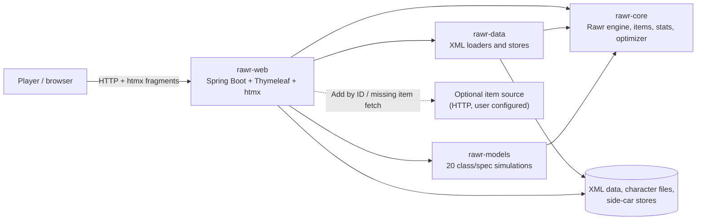

# JRawr Architecture

This directory is the public architecture handbook for JRawr. It explains how the application is
put together, how a web request becomes a model calculation, where game data comes from, and what
the optimizer actually runs. It is written for developers who need to change the code without
having to reconstruct the design from the source tree.

The code is the final authority. If this handbook and the code disagree, the code is correct; fix
the handbook.

## Reading order

| Document | Read it for |
|---|---|
| [System context](system-context.md) | The application boundary, runtime pieces and external inputs |
| [Modules and dependencies](modules.md) | Gradle modules, package layout, dependency rules and runtime wiring |
| [Web and API](web-and-api.md) | Spring Boot, request lifecycle, session state, HTMX fragments and the controller surface |
| [Engine and models](engine-and-models.md) | `Character` → `Calculations` → a spec model → `Stats` and ratings |
| [Data and import](data-and-import.md) | XML caches, character files, side-car stores, import and missing items |
| [Optimizer and jobs](optimizer-and-jobs.md) | Search, candidate generation, bounded jobs, progress and cancellation |
| [Testing](testing.md) | Java suites, golden-master verification, fixtures, tolerances and web tests |
| [Cross-cutting concerns](cross-cutting.md) | Concurrency, global settings, caches, errors, files and deployment |
| [Glossary](GLOSSARY.md) | Terms such as character, item instance, gemmed id, model, calculation and rating |

## At a glance

JRawr is a single Spring Boot web application that embeds the ported Rawr calculation engine. It
does not call a database or a remote service for normal operation. Game data is read from XML
caches at startup, characters are exchanged as Rawr XML files, and all model calculations run in
one JVM.

The important boundary is that `rawr-core` has no Spring, HTTP, template or browser dependency.
The web layer is a composition root: it loads data, registers models, creates characters, calls
the engine and renders the results.

## Architectural rules

- **`rawr-core` is the engine.** It contains the ported `Rawr.Base` types: character, items,
  stats, effects, calculations framework, optimizer and algorithms. It must not depend on
  `rawr-web`, Spring or a UI framework.
- **`rawr-models` contains the twenty simulations.** Each class/spec model depends on
  `rawr-core`; models do not depend on the web layer or on each other's implementation details.
- **`rawr-data` owns XML loading and persistent stores.** It depends on `rawr-core` and feeds the
  engine; it does not know about HTTP or sessions.
- **`rawr-web` is the only composition root.** It wires data, models and the engine together,
  owns the HTTP session and the background-job executors, and renders Thymeleaf/htmx views.
- **One calculation runs at a time.** The engine keeps process-wide mutable caches and a shared
  model registry. `CalculationService` serializes engine work behind a global lock; jobs use the
  same lock rather than running calculations concurrently.
- **Models are stateful.** A model instance may keep caches and per-run working state. The web
  layer uses a fresh model instance for each top-level calculation; do not assume a model is
  thread-safe or stateless.
- **Data is external and read at runtime.** The XML caches under the configured data directory
  are loaded by `rawr-data`; they are not compiled into the application.
- **The web UI is server-rendered.** Thymeleaf renders the shell and fragments; htmx swaps
  fragments in place. JavaScript is limited to UI behaviour, charts and progressive job updates.

## Diagrams

Most diagrams are Mermaid and render directly on GitHub and in IDEs that support Mermaid. Larger
dependency diagrams may also be kept as Graphviz sources under `diagrams/` when a layout needs more
control. Diagram source is part of the public documentation.

## Source map

| Path | Role |
|---|---|
| `jrawr/rawr-core/src/main/java/rawr/base/` | Rawr engine |
| `jrawr/rawr-models/src/main/java/rawr/models/` | Class/spec models |
| `jrawr/rawr-data/src/main/java/rawr/data/` | Cache loaders and file stores |
| `jrawr/rawr-web/src/main/java/rawr/web/` | Spring Boot application and controllers |
| `jrawr/rawr-web/src/main/resources/templates/` | Thymeleaf shell and fragments |
| `jrawr/rawr-web/src/main/resources/static/` | CSS and JavaScript |
| `jrawr/data/` | Shipped XML game-data caches |
| `jrawr/characters/` | Default saved-character directory for local runs |
