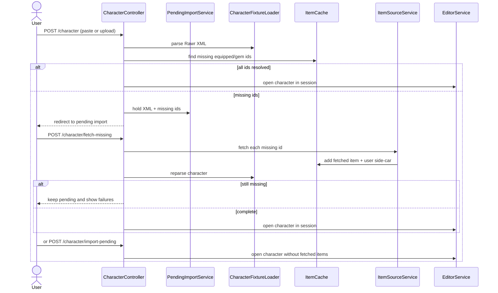

# Data and Import

JRawr keeps the original Rawr data model: XML files are the interchange format, and the application
loads them at runtime. Items, buffs, enchants, talents and item sources come from the XML caches. A
few code-defined fallback catalogues (the ported default buffs and enchants) also exist in
`rawr-core`; the item database itself is not embedded in Java.

## Data sources

| Data | Location / loader | Lifetime |
|---|---|---|
| Items | `data/ItemCache.xml` via `ItemCacheLoader` | Process-wide `ItemCache` |
| Buffs | `data/BuffCache.xml` via `BuffLoader` | Process-wide buff catalog |
| Enchants | `data/EnchantCache.xml` via `EnchantLoader` | Process-wide enchant catalog |
| Talent specs | `data/Talents.xml` via `TalentSpecLoader` | Process-wide talent spec catalog |
| Item sources | `data/ItemSource.xml` via `ItemSourceLoader` | Resolved source template for network fetches |
| Item filters | `data/ItemFilter.xml` plus the user side-car | `ItemFilterData` tree |
| Boss options | character XML plus the built-in boss list | `BossOptions` on the character |
| User items | `jrawr.items.xml` beside the characters directory | `UserItemStore` |
| Saved talent specs | `jrawr.talents.xml` beside the characters directory | `SavedTalentSpecStore` |
| Item filters/costs | side-car files beside the characters directory | `SavedItemFilterStore`, `ItemCostStore` |
| Icons | hotlinked from the configured icon site; no local cache | `ItemIconService` |

`DataBootstrap` fails fast when a required cache file is missing, loads the caches, loads the
side-cars and registers all twenty models in the `Calculations` registry. Startup is idempotent;
requests call `load()` defensively because Tomcat can accept a request before the
`ApplicationRunner` completes.

## Cache model

The engine uses process-wide caches rather than per-request repositories:

- `ItemCache` resolves item ids to `Item` templates and keeps the relevant-items caches.
- `Buff` and `Enchant` expose catalogs used by models and the editor.
- `Calculations` keeps the model class/instance registry.
- `SpecialEffect` keeps an interpolator cache.

These are shared across sessions and across requests. Engine work is serialized by
`CalculationService`; data-editor mutations that change item availability invalidate the relevant
caches. The web layer treats the caches as read-only except through the stores and cache-loading
APIs.

## Character XML

A character file contains:

- identity: name, realm, region, race, class, current model;
- gear slots as compact gemmed ids (`item.gem1.gem2.gem3.enchant`);
- the optimizer availability pool (`AvailableItems`);
- the active talent/glyph string for the class;
- primary and secondary professions;
- optional boss, calculation options and saved model state.

`CharacterFixtureLoader` is the reader used by both saved characters and tests. `Character.save`
writes the same shape. The loader accepts missing optional sections and creates defaults; unknown
item ids remain unresolved `ItemInstance`s and contribute no stats until the item is added or
fetched.

## Import flow

The critical rule is that an unknown equipped item is never silently treated as a normal item.
The import flow detects the ids first and gives the user three choices: fetch, import without
fetching, or cancel. Import without fetching is valid: the character retains the unresolved
instances, calculations treat them as empty, and the user can add the items later with the Item
editor. This is useful for server-custom items that the configured item source cannot provide.

## Add items by ID

The Item editor (`Tools > Item editor`) uses `ItemSourceService` to fetch item templates by ID.
The item picker has an `Add item` shortcut that opens the same editor. Fetched items are cached and
written to `UserItemStore`; the canonical shipped `ItemCache.xml` is never modified. Missing-item
import uses the same source.

## Side-car files

User data is kept separate from shipped data:

- `UserItemStore` writes only items added at runtime.
- `SavedTalentSpecStore` persists user talent specs and optimizer include/exclude selection.
- `SavedItemFilterStore` persists edited item filters.
- `ItemCostStore` persists per-item costs.
- Item icons are hotlinked from the configured source site; no local cache is kept.

The side-car files live next to the saved-character directory by default and can be relocated
through `jrawr.*` application properties. They are read at startup and rewritten on the relevant
editor action; no database is involved.

## Import/export compatibility

The XML shape is the original Rawr character format. The importer accepts the same slot names,
compact talent/glyph strings, gemmed ids and `AvailableItems` entries. The exporter writes the
same format, so files can move between JRawr and the original WotLK Rawr tool. Optional data such
as active buffs, boss definitions and model options are preserved when present; when absent the
application creates defaults.
