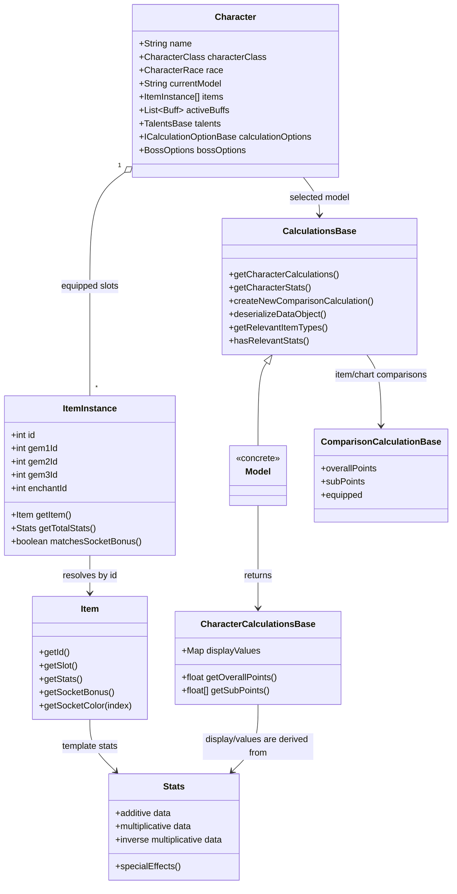
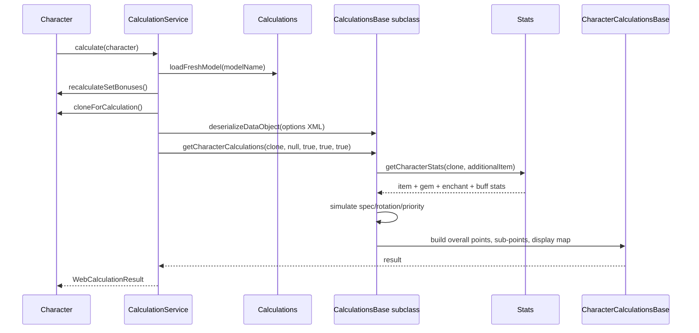

# Engine and Models

The engine turns a `Character` (gear, gems, enchants, buffs, talents, boss options and model
options) into a `CharacterCalculationsBase` result. The result contains the overall rating, its
sub-points and the display values the UI shows. The optimizer uses the same result; it does not
have a separate calculation path.

## Core types

`Character` is the aggregate root. It stores slot instances, active buffs, talents, professions,
boss configuration, optimization settings and the selected model. It does not perform the model
simulation itself.

`ItemInstance` is a resolved or unresolved item plus gem and enchant ids. Its `getItem()` looks up
the template in `ItemCache`; an unknown id is a valid state and contributes no stats or sockets.
`Stats` holds the additive, multiplicative and inverse-multiplicative stat data plus special
effects. The engine keeps the original C# numeric types and operation order.

## The model registry

`Calculations` is a static facade and registry:

- it maps a model name (`Mage`, `Cat`, `Warlock`, ...) to a `CalculationsBase` subclass;
- it creates and caches one instance per class;
- it loads the current model for the static helper methods;
- it can create a fresh model instance for a top-level calculation (`loadFreshModel`) so previous
  run state cannot leak into the next web request.

Models are stateful. A model may cache intermediate calculations, interpolation tables or solver
state. `Calculations` instances are shared process-wide, and the web layer serializes all engine
work behind one calculation lock. Treat model instances as single-threaded and avoid carrying
per-character state across calls unless the model explicitly manages it.

## Calculation sequence

The engine's common entry point does not fetch data. Everything a model needs must already be
loaded into the `Character` or the process-wide caches. The web layer ensures data is loaded,
resolves the model and the options, and clones the character before the call.

## Inputs

| Input | Stored on | Used by |
|---|---|---|
| Equipped items, gems, enchants | `Character` slot `ItemInstance`s | `accumulateItemStats`, item relevance and comparisons |
| Active buffs/debuffs | `Character.activeBuffs` | buff stat accumulation, model rotation and set-bonus context |
| Talents and glyphs | class-specific `TalentsBase` | model-specific talent effects and validity rules |
| Professions | `Character.primaryProfession` / `secondaryProfession` | profession-gated effects and enchants |
| Boss/encounter | `BossOptions` | target level, resistances, attacks and model assumptions |
| Model options | `ICalculationOptionBase` implementation | fight length, rotations, priorities, custom spell mix, etc. |
| Global settings | interceptor-applied statics/caches | profession gating, effect modes, threading |

## Outputs

`CharacterCalculationsBase` is the common result contract:

- `getOverallPoints()` — the single score the optimizer maximizes. Its unit is model-defined
  (DPS, HPS, threat or a weighted tank score).
- `getSubPoints()` — the score split into the model's dimensions; order matches the model's
  sub-point labels.
- `getCharacterDisplayCalculationValues()` — label-to-text map for the stats panel, with optional
  tooltip suffixes.
- optional asynchronous display values, auto-activated buffs and named optimizable values.

`ComparisonCalculationBase` is the lighter result used by item/chart comparisons. It carries an
overall value, sub-points and equipped/available markers for rows in a chart. A comparison is
produced by recalculating the character with one item replaced or added, not by a separate
formula.

## Where models live

Each package under `rawr-models` is one model. The entry point is a `CalculationsBase` subclass
(for example `rawr.models.mage.CalculationsMage`). It owns:

- model options serialization (`deserializeDataObject`);
- the spec simulation and rotation/priority logic;
- relevance filtering for items, buffs, enchants and gemming;
- model-specific comparison values;
- any solver or sequence builder needed for the spec.

Models should not parse XML files, open HTTP connections, read the HTTP session or render HTML.
Those responsibilities belong to `rawr-data` and `rawr-web`.

## Reading a model

Start at its `Calculations<Model>` class and follow the four framework methods:

1. `getCharacterCalculations` — the top-level result.
2. `getCharacterStats` — which stats the model needs and how they are accumulated.
3. `getRelevantItemTypes` / `hasRelevantStats` — why items and buffs are filtered.
4. `createNewComparisonCalculation` / `getItemCalculations` — how comparison and optimizer rows
   are built.

For a rotation or solver model, keep the model's option object open: its fields are the user
configuration that drives the simulation, and the model's default options are created by the web
calculation service when a character has none.
