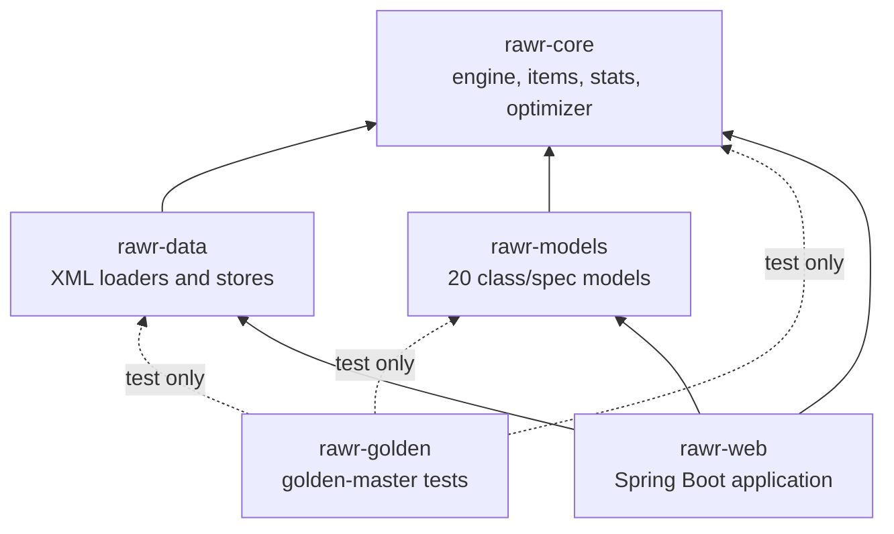
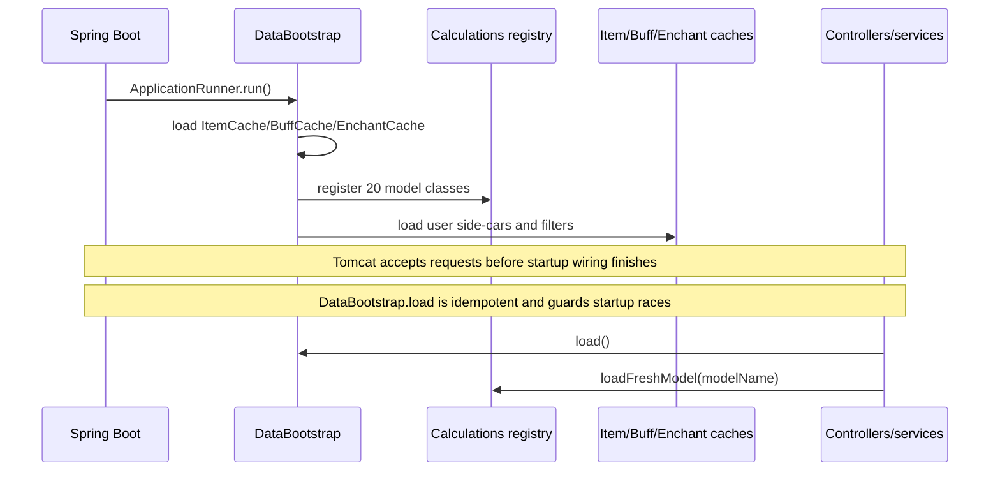

# Modules and Dependencies

JRawr is a Gradle multi-module build targeting Java 25. The dependency graph is deliberately
acyclic: the engine and models are independent of Spring, and the web module is the only place
where HTTP, templates and the engine are wired together.

## Gradle modules

`golden` is not a runtime dependency. It contains tests that compare the Java engine with frozen
oracle output; it is included in the build and verification lifecycle, not in the deployed jar.

## Module responsibilities

| Module | Responsibility | Must not depend on |
|---|---|---|
| `rawr-core` | Port of `Rawr.Base`: character model, items and instances, stats, special effects, talents, calculations framework, optimizer, algorithms, bosses, batch helpers | Spring, HTTP, Thymeleaf, `rawr-web` |
| `rawr-data` | Load and persist the original XML data formats: item/buff/enchant caches, talents, character fixtures, item sources, user items, talent specs, filters and costs | `rawr-web`, Spring MVC |
| `rawr-models` | One simulation per class/spec (Mage, Cat, Bear, Warlock, ...), including options, comparisons, rotations and model-specific solvers | `rawr-web`; models should not depend on another model except for the shared `rawr.models.mage.NetFormat` helper |
| `rawr-golden` | Golden-master and optimizer-verification tests; fresh-JVM fixture tasks | Production code |
| `rawr-web` | Spring Boot composition root: HTTP controllers, session editor state, calculation orchestration, import and jobs, Thymeleaf + htmx UI | Nothing above it |

## Dependency rules

1. **Core is the bottom of the graph.** It may use the JDK and Apache Commons Math only. This is
   what makes the engine usable from tests, CLI-style entry points and the web layer without a
   servlet environment.
2. **Data depends on core, never the reverse.** Core defines the data model; data knows how to
   read and write the XML representations.
3. **Models depend on core, not on data or web.** A model receives a resolved `Character` and
   returns a calculation result. Loading the character is the caller's job.
4. **Web is the composition root.** `DataBootstrap` registers models and loads caches, services
   create or clone characters, and `CalculationService` invokes the engine. No lower module knows
   that HTTP exists.
5. **Test-only edges do not become production edges.** Golden and web tests may depend on all
   modules, but production jars keep the graph above.

## Package map

### `rawr-core` — `rawr.base`

| Package | Contents |
|---|---|
| `character` | `Character`, slots, races, classes, professions, buffs, boss options, saved talent/buff specs |
| `items` | `Item`, `ItemInstance`, `ItemCache`, gems, enchants, filters, gemming templates, item sources |
| `stats` | `Stats`, additive/multiplicative/inverse stats, base stats, stat conversion |
| `effects` | Special effects, triggers, proc/uptime calculation |
| `talents` | Talent tree base classes and per-class talent arrays |
| `calculations` | `Calculations` registry, `CalculationsBase`, result and comparison base types, options interfaces |
| `optimizer` | Candidate generation, item optimizers, search base classes, upgrade values |
| `algorithms` | Numerical and solver helpers |
| `bosses` | Boss/encounter definitions and presets |
| `batch`, `util` | Batch helpers and shared utilities |

### `rawr-data` — `rawr.data`

The package contains loaders and stores rather than model logic:

- cache loaders: `ItemCacheLoader`, `BuffLoader`, `EnchantLoader`,
  `TalentSpecLoader`, `BossOptionsLoader`
- character XML: `CharacterFixtureLoader`, `XmlLoader`
- item sources: `ItemSourceLoader`, `FileItemSource`, `UrlTemplateItemSource`,
  `ItemSourceProvider`, `ItemSourceTemplates`
- user side-cars: `UserItemStore`, `SavedTalentSpecStore`, `SavedItemFilterStore`, `ItemCostStore`
- item parsing helpers: `ItemXmlParser`, `JsonParser`

### `rawr-models` — `rawr.models.<model>`

Each model package contains its `Calculations<Model>` entry point, its option object, its
comparison type and any model-specific solver or rotation state. The package names are the model
names used by the character file: `mage`, `cat`, `bear`, `moonkin`, `elemental`, `enhance`,
`healadin`, `healpriest`, `shadowpriest`, `protwarr`, `retribution`, `protpally`, `hunter`,
`rogue`, `restosham`, `tree`, `tankdk`, `dpsdk`, `warlock`, `dpswarr`.

### `rawr-web` — `rawr.web`

| Group | Classes |
|---|---|
| Application | `JRawrWebApplication`, `WebConfig`, `DataBootstrap` |
| Character editor | `CharacterController`, `EditorService`, `EditorViews`, `CharacterStore` |
| Calculation | `CalculationService`, `WebCalculationResult` |
| Import | `PendingImportService`, `ItemSourceService` |
| Gear/items | `ItemPickerService`, `EnchantService`, `GemService`, `AvailabilityService`, `ItemIconService`, `ItemTooltipService` |
| Talents/buffs/options | `TalentPanelService`, `TalentSpecService`, `ModelOptionsService`, `BossOptionsService` |
| Charts/comparison | `ComparisonService`, `ComparisonController`, `UpgradeListService` |
| Optimizer/jobs | `OptimizerController`, `OptimizerJobService`, `UpgradeJobService` |
| Tools/data editors | `ToolsController`, `ItemEditorService`, `ItemFilterService`, `GemmingTemplateService`, `ItemCostService` |
| Global settings | `GlobalSettings`, `GlobalSettingsService`, `GlobalSettingsInterceptor`, `GlobalSettingsAdvice` |

## Runtime wiring

`rawr-web` creates the session character lazily through `EditorService`, calculates through
`CalculationService`, and persists characters through `CharacterStore`. The optimizer and upgrade
services share the same `CalculationService` lock so a long job cannot race a normal editor
calculation.

## Build and verification

- Java toolchain: Java 25.
- Web stack: Spring Boot 4.1.1, Thymeleaf, htmx, validation.
- Core dependency: Apache Commons Math 3.6.1 (special functions).
- Tests: JUnit 5 and AssertJ; golden tasks run one fixture per fresh JVM because models keep
  state.
- `./gradlew build` builds every module and runs the enabled test suites. `rawr-golden` also
  exposes per-fixture verification tasks and optimizer/parallel checks.

See [Web and API](web-and-api.md) for the request path and [Engine and models](engine-and-models.md)
for the calculation contract.
