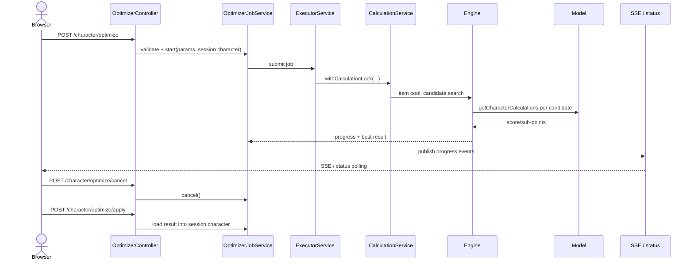

# Optimizer and Jobs

The optimizer searches combinations of items, gems, enchants, buffs and (optionally) talents for
the setup with the highest model score. It is not a separate calculation engine: every candidate
is evaluated through the same `CalculationsBase.getCharacterCalculations` contract described in
[Engine and models](engine-and-models.md).

## Components

| Component | Responsibility |
|---|---|
| `OptimizerBase` / `ItemOptimizer` / `ItemInstanceOptimizer` | Search algorithms and item candidate handling |
| `AvailableItemGenerator` | Expands the availability pool into gemmed item variants and filters candidates by slot/model relevance |
| `OptimizerValues` | Named optimizer objectives and constraints (overall, sub-points, cost, requirements) |
| `OptimizerCharacter` | The working copy/state used during search |
| `OptimizerJobService` | Web job lifecycle: parameter validation, bounded executor, progress, SSE, cancel and result |
| `UpgradeJobService` / `UpgradeListService` | The “evaluate one item” and upgrade-list jobs |
| `CalculationService` | Shared engine lock and fresh-model calculation boundary |

The search can use genetic, simulated-annealing and greedy methods, with a thoroughness/effort
setting. Talent search is a separate optional phase and is run single-threaded. Candidate
evaluation can be parallelized only for models verified to be deterministic under parallel
evaluation; the two excluded models remain sequential. Results must not depend on completion
order.

## Job lifecycle

The start endpoint is asynchronous. The browser follows the job through
`/character/optimize/status` or the text-event stream at `/character/optimize/stream`, and can
cancel it. A completed result is previewed before it is applied; applying it mutates the session
character and marks it dirty. The job itself never mutates the session character while running.

## Pool and candidate generation

The character's `AvailableItems` list is the starting point. Entries can be:

- bare item ids (any legal gemming),
- exact gemmed ids (item + gems + enchant),
- wildcard entries for gems/enchant,
- enchant tokens and other legacy entries.

`AvailableItemGenerator` expands the list into concrete item/gem/enchant instances, filters by
model relevance and slot fit, applies class/unique restrictions and uses gemming templates to
produce variants. The UI's item pool editor and filter editor feed the same model.

## Requirements and objectives

An optimizer run can optimize the overall score or a named sub-point/objective. Constraints can
include item cost, stat thresholds and other requirements. `OptimizerValues` evaluates both the
objective and the constraints for a candidate; a candidate that fails a requirement is rejected
even if its score is high.

## Concurrency and determinism

The engine has process-wide state: model instances, item/buff/enchant caches, special-effect
interpolation caches and the current model. The web layer therefore:

- serializes top-level calculations behind `CalculationService`'s fair lock;
- lets optimizer jobs use the same lock rather than running next to an editor calculation;
- creates a fresh model instance for each top-level calculation;
- limits parallel candidate evaluation to verified models and exposes a fixed-thread option for
  tests;
- keeps talent search single-threaded;
- computes results from candidate data, not from completion order.

For deterministic verification, run with one thread/fixed order and compare the best score and
selected state. The optimizer's tie-breaking and search order can differ from the original C#
implementation; the contract is that the Java best score is not worse than the reference beyond
the documented tolerance.

## Related UI

The full-screen Optimize mode contains the pool/slots, talent/glyph and consumable searches,
constraints and advanced settings. The gear-only upgrade list sits in Gear & pool. The result
preview shows per-slot diffs and can save the optimized setup as a separate character. See
[Web and API](web-and-api.md) for the controller routes and fragment boundaries.
