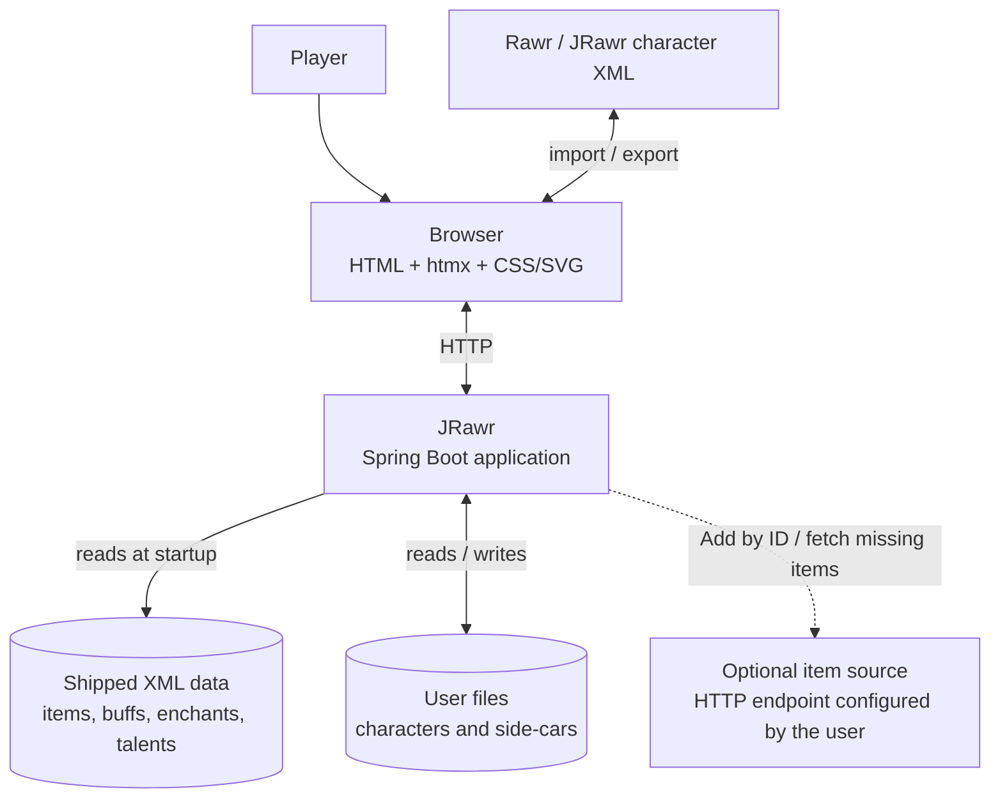
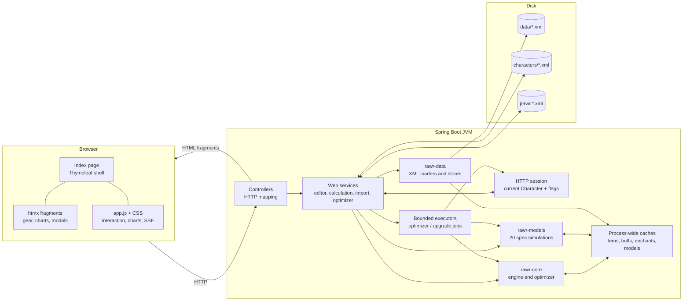

# System Context

JRawr is a self-contained Java application for Wrath of the Lich King 3.3.5a character
theorycrafting. A player edits a character in a browser; the server calculates the character with
one of the ported Rawr models; the browser renders ratings, stats, comparisons and optimizer
results.

## Context



The application is single-user in normal deployment. There is no account system, no multi-tenant
database and no server-side user directory. The HTTP session holds the character currently being
edited.

## Runtime containers



## Logical layers

| Layer | Responsibility | Examples |
|---|---|---|
| Presentation | Browser shell, fragments, CSS, charts, form controls | `templates/`, `static/js/`, `static/css/` |
| HTTP/controller | Route mapping, request parameters, validation, view selection | `CharacterController`, `OptimizerController`, `ComparisonController` |
| Web application services | Session character, calculation orchestration, import, comparisons, jobs | `EditorService`, `CalculationService`, `PendingImportService`, `OptimizerJobService` |
| Engine | Character model, items, stats, effects, calculations framework, optimizer | `rawr-core` |
| Models | One simulation per class/spec | `rawr-models` |
| Data access | XML cache loading and side-car persistence | `rawr-data` |
| External data | Shipped game data and user files | `jrawr/data/`, configured characters directory |

Dependencies point downward. Presentation and HTTP depend on services; services depend on the
engine and models; the engine knows nothing about the web layer.

## External interfaces

### HTTP

The browser is the only normal client. The server renders a complete HTML shell for `GET /` and
smaller HTML fragments for htmx requests. JSON is used for progressive job status, streamed with
server-sent events, and for a few helper endpoints. Static files are served by Spring Boot.

### Character XML

Characters are imported and exported in the original Rawr character XML format. The same format is
used for saved files on disk. A character file contains metadata, equipped slots as compact
gemmed ids, an optimizer availability pool, talents and glyphs, professions and optional model
configuration. Import can also receive an XML upload or a pasted document.

### Game data XML

`ItemCache.xml`, `BuffCache.xml` and `EnchantCache.xml` are loaded at startup from the configured
data directory. `Talents.xml`, `ItemSource.xml` and `ItemFilter.xml` are optional files in the same
directory. Talent icon and per-rank description metadata is a classpath resource in the web jar.
User-editable filters, costs, saved specs and fetched items live in side-car files next to the
characters directory. Game data is data, not generated Java code.

### Optional item source

The application can fetch an item by id from a user-configured HTTP source. This is used by Add by
ID and the missing-item import flow. Normal character editing and calculation never require a
network connection.

## Deployment

The application is a Spring Boot executable jar. The standard local development command is:

```bash
cd jrawr
./gradlew :rawr-web:bootRun
```

The shipped data directory is `jrawr/data` for local runs. In production the data directory,
characters directory and side-car files are configured with the `jrawr.*` application properties.
Item icons are hotlinked from the configured source site and are never stored locally. The server
is a single JVM; jobs and calculations are bounded by the process resources and the calculation
lock described in [Cross-cutting concerns](cross-cutting.md).

## What is intentionally outside the context

- The original C# Rawr application and its UI.
- Armory, Wowhead character import and bulk item-cache refresh.
- A database server, message broker or distributed job runner.
- Multi-user authentication and authorization.

These are either obsolete, explicitly unsupported, or future work outside the current operating
model.
