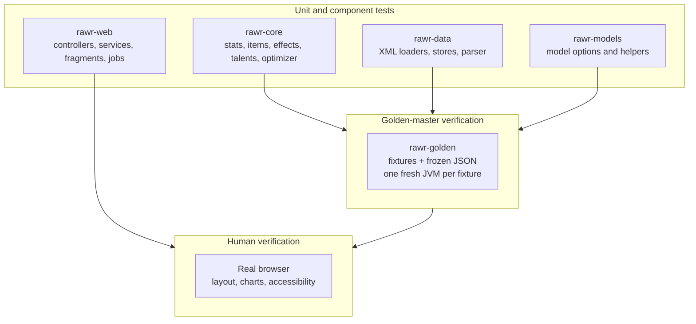
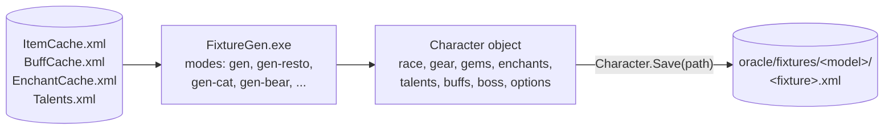
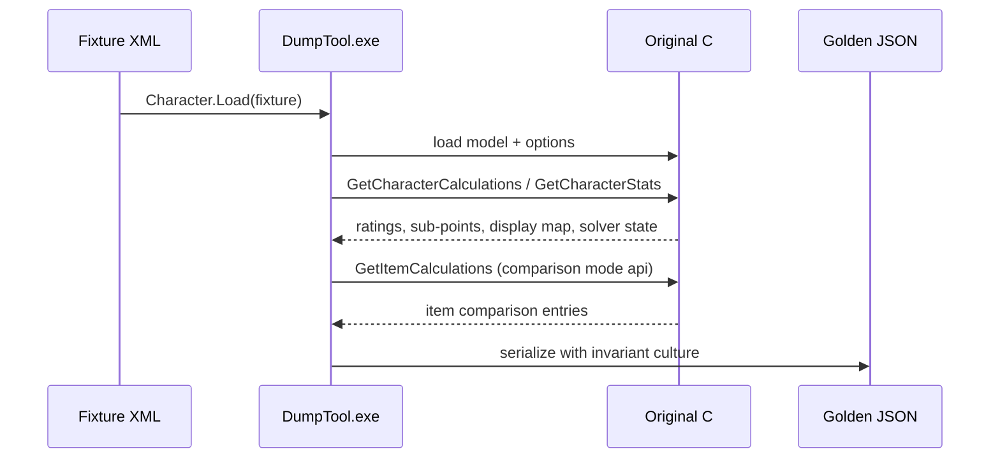

# Testing

JRawr is tested at three levels: ordinary Java unit/integration tests, golden-master tests that
compare the Java engine against the original C# implementation, and web tests that exercise the
Spring Boot layer without a browser or network. The test suites are designed to be deterministic,
offline and fast enough to run in the normal build.

## Test layers



| Level | What it proves | Where |
|---|---|---|
| Unit/component | One class or small collaboration behaves as specified | `rawr-core`, `rawr-data`, `rawr-models`, `rawr-web` test sources |
| Golden master | The Java port produces the original engine’s numbers and model decisions | `rawr-golden` |
| Web integration | Spring wiring, sessions, fragments, redirects, import and job flows | `rawr-web` tests with MockMvc |
| Browser smoke | Selected JavaScript/UI behaviour in a headless browser | `rawr-web` tests with HtmlUnit |
| Manual | Real browser rendering, layout, accessibility and platform differences | Human checklist |

## Running the Java suites

From the `jrawr/` directory:

```bash
./gradlew build
```

`build` runs the enabled tests in every module. For a focused run:

```bash
./gradlew :rawr-core:test
./gradlew :rawr-data:test
./gradlew :rawr-models:test
./gradlew :rawr-web:test
```

The shared `test` task excludes the tagged golden suites. `check`/`build` runs
`goldenAllParallel`, which executes every golden, optimizer, parallel-verification and
relative-stat fixture in its own JVM through a small process pool. The generated per-fixture
`Test` tasks (for example `:rawr-golden:mageGolden_<fixture>`) remain available for focused runs.

To run the golden verification explicitly:

```bash
./gradlew :rawr-golden:check
```

## Golden-master tests

A golden test compares the Java model with the original C# engine for the same input character.
Two different file types are involved:

- **Fixture XML** is the input: a character saved in the original Rawr character XML format.
- **Golden JSON** is the expected output: ratings, stats, display values, comparisons and solver
  data dumped by the original C# engine.

There is no “golden XML” output. The XML files are fixtures; the frozen expected results are JSON.

### How fixture XML is generated

Fixtures are produced by the small C# program in the development `oracle/fixture-gen` tool. It is
compiled by `oracle/build.sh` with Mono’s `mcs` against the **prebuilt original Rawr assemblies**.
The original C# project is not rebuilt, and the legacy runtime is never modified.



A fixture generator mode does the following:

1. Loads the original caches (`ItemCache.Load()`, buffs, enchants, talents) from the linked
   legacy data directory.
2. Chooses a race, class and current model and creates a `Character`.
3. Equips items by item id. For each socket it picks a gem appropriate to the socket color and
   applies the scenario’s enchants. Item ids are verified with `ItemCache.FindItemById`; a missing
   id throws instead of silently producing a broken fixture.
4. Sets talents and glyphs. Some specs come from the shipped `Talents.xml`/`Talents.Default.xml`;
   specs not shipped there are built property by property in the generator.
5. Applies active buffs, professions, boss options, model options (fight length, movement,
   latency, cooldowns, rotations, custom spell mixes, and so on) and the optimizer availability
   pool.
6. Calls `Character.Save(path)`, which writes the fixture in the original Rawr XML format.

The `list-*` modes print the available shipped talent specs and candidate items without writing
anything; the corresponding `gen-* <dir>` mode writes the fixture set. Examples include Mage gear
sets at ilvl 264/277, no-buff and blank baselines, mana-starved and cooldown-stacked fights,
T10 set bonuses and proc trinkets, and equivalent scenario families for every model.

Fixtures are committed under `oracle/fixtures/<model>/`. A full development checkout therefore
contains both the generated XML and the golden JSON; the runtime application does not read this
directory.

### How golden JSON is generated

For each fixture, the C# `oracle/dump-tool` loads the character with the original
`Character.Load`, selects the model, installs or restores the model options, recalculates set
bonuses and runs the original calculation entry points.



The dump is performed with `mono --interp` because the Mono 6.14 JIT can abort in one of the
Mage cycle methods; the interpreter executes the same IL and produces identical values. It is a
tooling workaround, not a behavior change.

A calculation golden contains:

| JSON key | Contents |
|---|---|
| `model`, `fixture` | Model name and fixture name |
| `character` | Name, race, class, model, professions, active buffs, set-bonus counts and equipped item data |
| `calculatedStats` | The full resolved `Stats` snapshot |
| `ratings` | Overall points and sub-points |
| `display` | Display values and label metadata |
| `solver` | For solver-heavy models such as Mage: candidate cycles, selected cycle, mana segments and cooldown/reconstruction data |
| `comparison` | Item comparison entries produced through `GetItemCalculations` |

The comparison mode controls the `comparison` block:

- **`api`** uses the original application’s comparison API (`CalculationsBase.GetItemCalculations`)
  and is the mode used by the committed goldens.
- **`direct`** is a fallback that clones the character, equips the item and runs a reference
  calculation.
- **`none`** omits the comparison block.

Numbers are serialized with the invariant culture (`G9` for `float`, `G17` for `double`), so the
JSON is independent of the machine’s locale. The JSON is written as UTF-8 without a BOM.

### Optimizer and relative-stat goldens

Optimizer goldens are produced by the same dump tool in `optimize` mode. They use a fixed pool:
for Head, Chest and MainHand, the first 25 model-relevant items that fit the slot (sorted by id),
plus every currently equipped item id. The dump records the exact pool, the driving parameters
and the C# best result. The C# optimizer uses a time-based genetic-algorithm seed, so re-dumping is
not byte-identical; the committed JSON is the oracle. The verifier compares only the objective
value, not the chosen item set:

```text
javaBest >= csharpBest - max(1.0, abs(csharpBest) * 1e-4)
```

The Java-side fixed seed is recorded in each golden for reproducibility; a few fixtures use a
different seed to avoid a Java local optimum. Parallel candidate evaluation is verified
separately: the sequential and parallel runs must produce the same result for the models marked
safe for parallel evaluation.

Relative-stat goldens use `DumpTool ... relative <model>` and capture
`CalculationsBase.GetRelativeStatValues`. The committed set covers normalized and non-normalized
models (Mage/Cat and Enhance). Optimizer, relative-stat and parallel tasks are part of `check`.

### Refresh commands

These commands assume a full development checkout with the prebuilt original C# assemblies and the
`oracle/` tools. They are not run by the normal Java build.

Create the read-only legacy checkout first, or point `RAWR_LEGACY_DIR` at an existing one:

```bash
tools/setup-legacy.sh
```

Then refresh the oracle:

```bash
./oracle/run.sh                 # Mage fixtures + goldens
./oracle/run.sh cat             # one model
./oracle/run.sh optimize        # fixed-pool optimizer goldens
./oracle/run.sh relative-stats  # relative-stat goldens
```

A single fixture can be dumped from a built `oracle/dump-tool/bin`:

```bash
cd oracle/dump-tool/bin
MONO_PATH="$PWD/Data" mono --interp DumpTool.exe \
  ../../fixtures/mage/<fixture>.xml \
  ../../golden/mage/<fixture>.json api mage
```

### Java side of a golden test

Each model has a `rawr-golden` test class tagged with its model name, for example
`@Tag("mage-golden")`. The test:

1. resolves the fixture and golden directories;
2. lists the fixtures, or filters to the one named by `jrawr.fixture`;
3. loads the fixture through `CharacterFixtureLoader`;
4. runs the Java model with the same options;
5. compares ratings, stats, display values, comparisons and solver fields against the JSON.

`rawr-golden/build.gradle` creates one `Test` task per fixture and sets `jrawr.fixture` for that
task. The model suites are tagged and excluded from the shared `test` task, so each fixture gets a
fresh JVM and no model state leaks between fixtures.

### Why one fresh JVM per fixture

Models keep static and per-instance carry-over state: caches, solver scratch data and the shared
model registry. A suite that reuses one JVM across fixtures can make results depend on test order.
The golden build therefore runs every fixture in a dedicated JVM and also creates one `Test` task
per fixture for focused runs. A separate determinism test repeats a calculation inside one JVM and
checks that the result is stable.

### What is compared

| Category | Comparison |
|---|---|
| Ratings and sub-points | Numeric, with the documented tolerance |
| Stats fields | Numeric, with tolerance; integers/enums/strings exact |
| Display strings | Exact where they are deterministic labels/values |
| Item/comparison results | Numeric and structural |
| Solver intermediates | Candidate/selected values compared so a failure localizes the first divergence |
| Optimizer | The Java best score must be at least the reference best score minus tolerance; the exact chosen item set is not compared |

The default numeric tolerance is relative `1e-9`, with an absolute `1e-12` floor for values near
zero. A tolerance or expected-value change requires a documented reason and is limited to the
affected field. Tests are not weakened to hide a mismatch; the first differing value in dependency
order is fixed instead.

### Adding a golden test

1. Add a fixture scenario to the model’s `FixtureGen` mode and regenerate that model’s fixture
   directory, or add a carefully validated character XML fixture.
2. Run the dump tool for the new fixture and inspect the generated JSON.
3. Add the Java model/fixture mapping only when introducing a new model or suite.
4. Run the generated `rawr-golden` task.
5. On a mismatch, inspect the first differing field in this order: item resolution → stats →
   spell/rotation values → solver/cycle state → final ratings.
6. Fix the port, not the golden. If the reference itself is wrong or ambiguous, record a
   documented deviation rather than silently changing the test.

## Web tests

The web module uses Spring Boot’s test support and runs offline:

- `@SpringBootTest` + MockMvc tests exercise controllers, sessions, redirects, fragments, jobs and
  form validation.
- HtmlUnit covers selected JavaScript behaviour such as availability checkboxes and import
  handlers.
- A loopback HTTP server is used where the missing-item/source flow needs an HTTP response; no
  external service is contacted.
- The web tests use the copied game-data caches and temporary character/side-car directories.
- Performance-budget tests put generous wall-clock ceilings on selected UI/optimizer operations;
  they are regression guards, not porting assertions.

Web tests intentionally do not prove:

- that the HTML looks correct at every resolution;
- that a real browser, clipboard or network source behaves as expected;
- multi-user or multi-JVM concurrency.

Those are covered by manual browser checks. The server is designed for a single JVM; the
calculation lock and session model are intentionally simple. The companion
[JRawrCharacterExporter](https://github.com/AdrianoBotti/JRawrCharacterExporter) addon has its own
in-game test checklist in its repository.

## Test data and isolation

Tests use:

- the shipped `jrawr/data` caches (or a copied fixture in tests);
- temporary directories for saved characters and side-cars;
- loopback HTTP servers for optional network-source paths;
- frozen character fixtures and JSON for the golden suite.

Tests must not require a real WoW client, an internet connection or a running external database.
When a test needs an item that is not in the cache, it either creates a minimal item fixture or
uses a dedicated store; it must not modify the canonical `ItemCache.xml`.

## Current coverage and limits

The suite covers the twenty models, item/gem/enchant resolution, buffs and set bonuses, talents and
glyphs, model options, comparison charts, relative stats, optimizer scoring and parallelism, the
character XML import/export path, session editor fragments, settings, data editors and missing-item
flows.

It does not replace a real-browser run. Layout, accessibility, chart rendering and clipboard
behaviour remain manual checks before a release.
