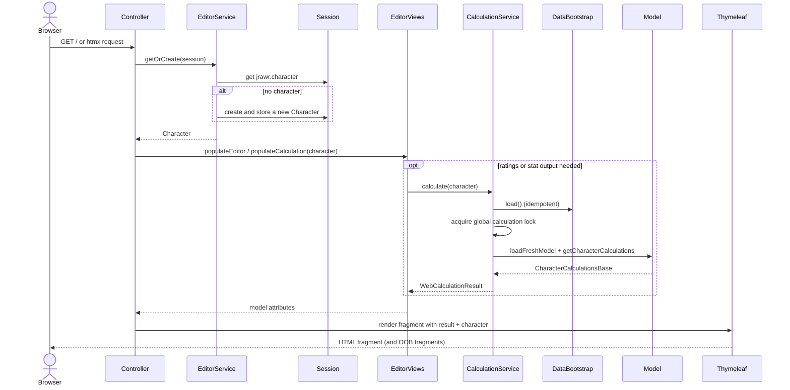

# Web and API

`rawr-web` is a Spring Boot MVC application with a server-rendered Thymeleaf shell and htmx
fragments. The browser never talks to the engine directly: it sends HTML form posts or htmx
requests, the controller mutates the session character, the calculation service runs the selected
model, and the response is a fragment plus out-of-band updates for the affected panels.

## Composition root

`JRawrWebApplication` starts Spring Boot and creates the file-backed stores for user items, saved
talent specs, item filters and item costs. `DataBootstrap` is an `ApplicationRunner` that loads the
game-data caches and registers the twenty models in `Calculations` before normal work begins.
`WebConfig` installs the global-settings interceptor, and `application.properties` defines the data
directory, characters directory, side-car paths, upload limits and template caching.

The controllers are deliberately thin: they translate HTTP inputs, call a service or mutate the
session character, then choose a template fragment. Calculation itself is centralized in
`CalculationService`; no controller calls a model directly.

## Request lifecycle

The `getOrCreate` call returns the session `Character` to the controller. The controller asks
`EditorViews` to populate the template model; its `populateCalculation` step calls
`CalculationService` only when the response needs ratings or stats. File, modal and editor actions
that do not need a new calculation skip that step.

A mutation follows the same path but starts with a form or htmx POST. The controller applies the
change to the session character, marks the editor dirty, recalculates when required and returns the
replacement fragment. htmx swaps the target element; responses may also contain out-of-band
fragments for the header, paper doll and stats panel.

## htmx and fragment model

`templates/index.html` is the full page shell. It contains the Build/Optimize top-bar modes, the
Character menu, the About/Tools/Appearance/Settings dialogs, the character header, paper doll,
charts pane and the fixed modal/toast containers. The page includes fragments such as:

- `fragments/character.html` — character header and meta form
- `fragments/paperdoll.html` — gear slots, enchants and gem controls
- `fragments/stats.html` — ratings, sub-points and display groups
- `fragments/talents.html`, `fragments/buffs.html` — talent/glyph and buff editors
- `fragments/compare.html` — chart pane and chart tabs
- `fragments/optimize.html`, `fragments/upgrades.html` — optimizer and upgrade flows
- `fragments/item-editor.html`, `fragments/tools.html`, `fragments/appearance.html` — Tools dialogs
- modal fragments for import, settings, about, boss, options, specs, availability, filters,
  gemming templates and costs

The server owns the source of truth for the current character; the browser owns only transient
selection and expansion state. JavaScript in `static/js/` (`app.js`, `item-editor.js` and
`theme.js`) handles interaction details such as chart drawing, modal focus/escape behaviour,
debounce/auto-refresh and server-sent event consumption. It does not calculate ratings.

## Session state

The HTTP session holds the live editor character and a small amount of workflow state:

| Attribute | Purpose |
|---|---|
| `jrawr.character` | Current `Character` instance |
| `jrawr.characterFile` | File name backing the character, if any |
| `jrawr.characterDirty` | Unsaved-changes flag |
| `jrawr.optimizer.settings` | Last submitted optimizer form settings |
| pending-import attributes | Held character XML, missing IDs, fetch status and error |
| pending-import fetching flag | Prevent concurrent missing-item fetch operations for the session |

Session state is per-user and in-memory. Restarting the server or losing the session loses the
unsaved character; saved characters are files. The application does not authenticate users or
share a session store between JVMs.

## Controller surface

The full route list is in [API](API.md). The main groups are:

| Group | Representative routes | Responsibility |
|---|---|---|
| Character/editor | `GET /`, `POST /character/meta`, `POST /character/slot`, `/character/buffs`, `/character/talents`, `/character/glyphs` | Mutate the session character and return editor fragments |
| Files/import | `/character/new`, `/characters`, `/character/open`, `/character/save`, `/character/save-as`, `/character/download`, `/character/import` | File-backed character lifecycle and Rawr XML import/export |
| Missing-item import | `/character`, `/character/fetch-missing`, `/character/import-pending`, `/character/cancel-pending` | Hold an import with unknown item ids; fetch or import without fetching |
| Gear/items | `/items`, `/enchants`, `/gems`, `/character/slot/instance`, `/character/slot/enchant`, `/character/slot/gem` | Item picker and enchant/gem selection |
| Charts/comparison | `/character/compare`, `/character/compare/body`, `/character/compare/availability` | Item, upgrade, enchant, talent, glyph, buff, gem and stat charts |
| Optimizer | `/character/optimize`, `/character/optimize/live`, `/character/optimize/status`, `/character/optimize/stream`, `/character/optimize/cancel`, `/character/optimize/apply` | Start, stream, cancel and apply optimizer jobs |
| Upgrades | `/character/upgrades`, `/character/upgrades/status`, `/character/upgrades/evaluate` | Evaluate one item and compute per-slot upgrade lists |
| Options/boss/settings | `/character/options`, `/character/boss`, `/settings` | Model options, boss configuration and global calculation settings |
| Tools | `/tools` | Global data-editor hub: item editor, filters, gemming templates and costs |
| Data editors | `/character/availability`, `/character/item-filters`, `/character/gemming-templates`, `/character/item-costs` | Custom item pool, filters, gemming templates and costs |
| Helpers | `/item-tooltip` | Item tooltip fragment; item icons are hotlinked URLs |

## API conventions

- **HTML first.** Most responses are Thymeleaf fragments, not JSON. A `200` with an HTML fragment
  is the normal success response for an htmx interaction.
- **Redirect after whole-page actions.** File operations and import decisions usually redirect to
  `/` with query flags such as `?open=import`, `?pending=1`, `?imported=1` or `?fetched=N`.
- **POST for mutation.** Character edits, file operations, job control and data-editor changes are
  POSTs. GET is reserved for reading pages/fragments and exporting files.
- **Session character is the input.** Most character routes do not accept a full character in the
  request body; they mutate the session character identified by the HTTP session.
- **Jobs are asynchronous.** Optimizer/upgrade start endpoints return quickly; progress is read
  through status polling or SSE and results are fetched/apply through separate endpoints.
- **Errors are visible HTML.** Validation failures generally re-render the modal/fragment with an
  error message rather than returning a bare JSON problem.

## Calculation boundary

`CalculationService` is the only place that turns a session `Character` into ratings. It:

1. validates that the character's `CurrentModel` is one of the twenty registered names;
2. ensures the data caches are loaded;
3. takes the process-wide calculation lock;
4. loads a fresh model instance for the current model;
5. ensures the character has calculation options (creating model defaults when needed);
6. recalculates set bonuses, clones the character for calculation and deserializes a fresh options
   copy so the session character is not mutated by model scratch state;
7. calls the model's `getCharacterCalculations` entry point and wraps the result in
   `WebCalculationResult` for the template.

This boundary is why the web layer does not need to know how a model works. It only needs a model
name, a resolved character and a result object with overall points, sub-points, display values and
labels.
